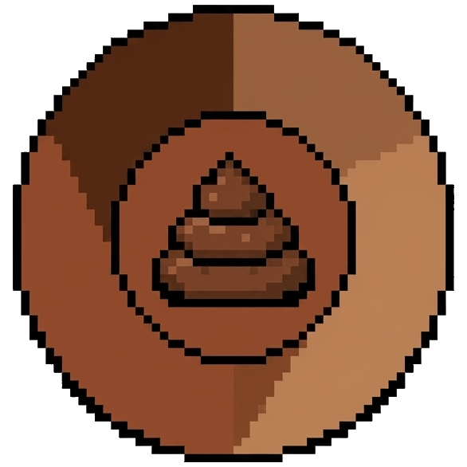

  

<h1 align="center">💩 Bostium Browser</h1>

  <b>O navegador com nome duvidoso, mas que humilha o Chrome no consumo de RAM.</b> 
  Leve, rápido, com Picture-in-Picture estilo Opera em qualquer vídeo e tecnologia de Guias Fantasmas.

  
  </a>
  </a>
  </a>

---

## 📥 Downloads Oficiais

Escolha a sua versão e pare de passar raiva com navegador travando:

| Pacote | Plataforma | Tamanho | Descrição | Link de Download |
| :--- | :---: | :---: | :--- | :--- |
| **Instalador Oficial** | Windows | ~2.5 MB | Instala para o usuário (sem pedir admin) com atalhos e desinstalador limpo. | [🚀 **Baixar Bostium_Setup.exe**](https://github.com/Thiagox47/Bostium/raw/main/Bostium_Setup.exe) |
| **Versão Portátil** | Windows | ~560 KB | Não precisa instalar nada! Descompacte em qualquer pasta ou pendrive e use. | [🎒 **Baixar Bostium_Portatil.zip**](https://github.com/Thiagox47/Bostium/raw/main/Bostium_Portatil.zip) |
| **Pacote Debian/Ubuntu** | Linux Nativo | ~224 KB | Pacote oficial (.deb) para Ubuntu, Debian, Linux Mint, Pop!_OS (100% nativo, sem Wine). | [🐧 **Baixar bostium_1.0_all.deb**](https://github.com/Thiagox47/Bostium/raw/main/bostium_1.0_all.deb) |
| **Pacote Universal Linux** | Linux Nativo | ~226 KB | Pacote portátil (.tar.gz) com instalador para qualquer distribuição Linux. | [📦 **Baixar Bostium-Linux-Nativo.tar.gz**](https://github.com/Thiagox47/Bostium/raw/main/Bostium-Linux-Nativo.tar.gz) |

👉 Você também pode conferir o histórico completo na [Página de Releases do GitHub](https://github.com/Thiagox47/Bostium/releases).

---

## 🧐 O que é o Bostium?

Você já reparou que você abre três abas no Chrome ou Edge e de repente o cooler do seu PC parece uma turbina de Boeing 747 decolando? Pois é. Nós também cansamos disso.

O **Bostium** nasceu com uma proposta simples: ter um nome despretensioso e cômico, mas entregar por dentro **engenharia de software cirúrgica**. Ele traz o poder do motor Chromium mais recente, uma interface Dark moderna, botão flutuante de Picture-in-Picture sobre **qualquer** vídeo da internet e a inovadora arquitetura **Ghost Tabs**, que não deixa o navegador devorar a sua memória RAM.

---

## ⚡ Recursos que fazem outros navegadores chorar no banho

### 👻 1. Arquitetura Ghost Tabs (Guias Fantasmas)
Outros navegadores deixam 40 abas abertas rodando JavaScript em segundo plano e devorando 6 GB de RAM. 
O Bostium é esperto:
- Ele mantém ativos apenas os motores das abas que você está realmente usando (limite inteligente de 2 motores).
- Abas que você não clica há algum tempo entram em **Hibernação Profunda (`💤`)**. O consumo de CPU e RAM delas cai para **zero**.
- Ao clicar na aba hibernada, ela acorda instantaneamente exatamente onde você estava.
- Quer ouvir música no YouTube ou manter um dashboard sem dormir? Basta clicar em **📌 Fixar Guia** (ela ganha imunidade perpétua).

### 📺 2. Picture-in-Picture Flutuante Estilo Opera
Passe o mouse por cima de **qualquer** vídeo (YouTube, Twitch, Netflix, feeds ou reprodutores genéricos) e uma pílula translúcida elegante surge no topo do vídeo dizendo: **"Destacar Vídeo"**. 
Um clique e o vídeo se solta da página em uma janela flutuante sempre no topo, para você continuar assistindo enquanto programa, joga ou trabalha.

### 🧹 3. Botão de Faxina Turbo de RAM
No canto superior direito, o badge `⚡ ... MB` mostra em tempo real quanto de memória o Bostium está usando. Quer liberar memória para abrir aquele jogo pesado? Dê um clique nele (ou use `Ctrl+Shift+O`) para forçar o descarte de WorkingSet com as APIs nativas do Windows.

### 💾 4. Restauração Multi-Janela com Memória Fotográfica
Se você usa múltiplos monitores ou gosta de organizar o Bostium em duas janelas separadas da tela:
- Ao fechar o navegador, ele memoriza não só as abas, mas as **coordenadas exatas (X, Y, Largura, Altura e Maximizado)** de cada janela.
- Quando você abre o Bostium novamente, ele reabre todas as janelas nos seus devidos lugares e com suas respectivas abas salvas!

### ⭐ 5. Barra de Favoritos Prática
Adicione páginas com um clique na estrela do endereço (`Ctrl+D`), abra em nova aba com o botão do meio e oculte ou exiba a barra quando quiser com `Ctrl+Shift+B`.

---

## ⌨️ Tabela Sagrada de Atalhos

| Atalho | O que ele faz? |
| :--- | :--- |
| `Ctrl + T` | Cria uma nova guia do Google. |
| `Ctrl + W` | Fecha a guia atualmente ativa. |
| `Ctrl + N` | Abre uma nova janela limpa e independente do Bostium. |
| `Ctrl + D` | Adiciona ou remove a página atual dos Favoritos (estrela ⭐). |
| `Ctrl + Shift + B` | Alterna a visibilidade da Barra de Favoritos (mostrar/ocultar). |
| `Ctrl + Shift + P` | Destaca ou recolhe o vídeo da página no modo **Picture-in-Picture**. |
| `Ctrl + Shift + O` | Executa a **Otimização Turbo de RAM** imediata. |
| `Ctrl + L` | Foca diretamente na barra de endereço (Omnibox) e seleciona o link. |
| `Ctrl + R` ou `F5` | Recarrega a página da web atual. |
| **Scroll do Mouse (na barra de guias)** | Rola o mouse para cima ou para baixo para trocar de aba na velocidade da luz. |
| **Clique do Meio (Scroll)** em uma aba | Fecha a aba imediatamente sem precisar acertar o 'X'. |
| **Clique do Meio** no vazio da barra | Cria uma nova guia rapidamente. |
| **Clique do Meio** em um Favorito | Abre o site salvo em uma nova aba em segundo plano. |

---

## 🛠️ Tecnologias Utilizadas

O Bostium foi desenvolvido combinando linguagens de alto desempenho e APIs de baixo nível:

- **C# / .NET**: Código moderno, modular e otimizado com compilação direta x64.
- **Motor Microsoft Edge WebView2 (Chromium)**: Renderização veloz de HTML5, CSS Grid, WebGL, WebAssembly e suporte total a sites modernos.
- **Win32 P/Invoke (`kernel32.dll`, `user32.dll`, `psapi.dll`)**: Chamadas diretas ao kernel do Windows para ajuste de DPI por monitor e esvaziamento de WorkingSet de memória.
- **JavaScript Injetado Assíncrono**: Script dinâmico que detecta eventos no DOM e constrói a interface flutuante de PiP sem injetar dependências pesadas na página.
- **Inno Setup 6**: Instalador ultra-compacto com compressão sólida LZMA2.

---

## 🔒 Mas afinal... O Bostium é seguro?

**Sim, extremamente seguro!** 

1. **Mesma Sandbox do Google Chrome e Edge**: O Bostium não inventou uma engine do zero da cabeça dele. Ele utiliza o motor Chromium oficial da Microsoft, com todo o isolamento de processos (*sandbox*), mitigação de exploits de memória e validação rigorosa de certificados SSL/TLS (`https://`).
2. **Seus logins e senhas ficam no SEU computador**: Se você salvar login ou preenchimento automático, seus dados são criptografados com a chave única do seu usuário do Windows através da tecnologia nativa **DPAPI** (`CryptProtectData`). Nem mesmo nós temos acesso.
3. **Zero Telemetria e Zero Rastreadores**: O Bostium não tem anúncios, não vende o seu histórico para corretores de dados e não fica mandando relatórios de uso escondidos para a nuvem.
4. **Integridade Garantida**: O navegador utiliza diretamente as bibliotecas oficiais da Microsoft (`Microsoft.Web.WebView2`), garantindo que nenhum código malicioso ou dependência externa duvidosa seja executada no seu sistema.

---

## 🚀 Como Instalar e Rodar

1. **Via Instalador (Recomendado)**:
   - Baixe o [**`Bostium_Setup.exe`**](https://github.com/Thiagox47/Bostium/raw/main/Bostium_Setup.exe).
   - Execute o instalador para criar os atalhos automáticos na sua Área de Trabalho e Menu Iniciar.
   - Pronto! O Bostium já está instalado com desinstalador limpo do Windows.

2. **Versão Portátil (Sem Instalação)**:
   - Baixe o [**`Bostium_Portatil.zip`**](https://github.com/Thiagox47/Bostium/raw/main/Bostium_Portatil.zip).
   - Extraia o conteúdo para qualquer pasta ou pendrive.
   - Execute o `Bostium.exe`. Não altera o registro do Windows nem requer privilégios de administrador.

---

  Feito por <a href="https://github.com/Thiagox47">Thiago</a>.

